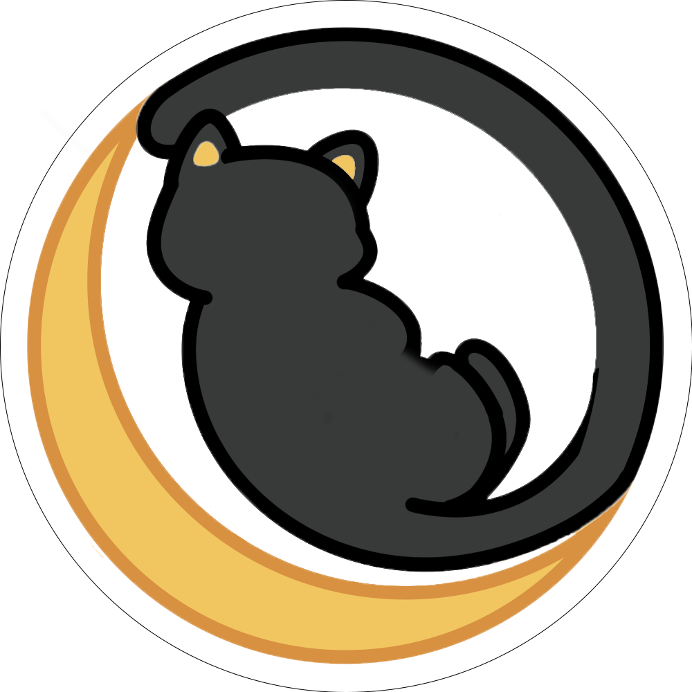
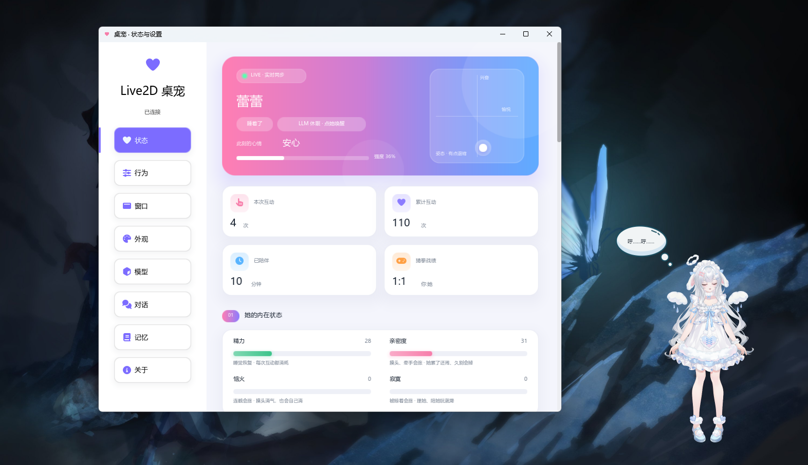
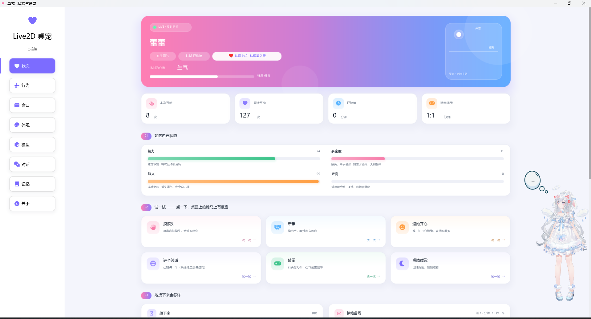
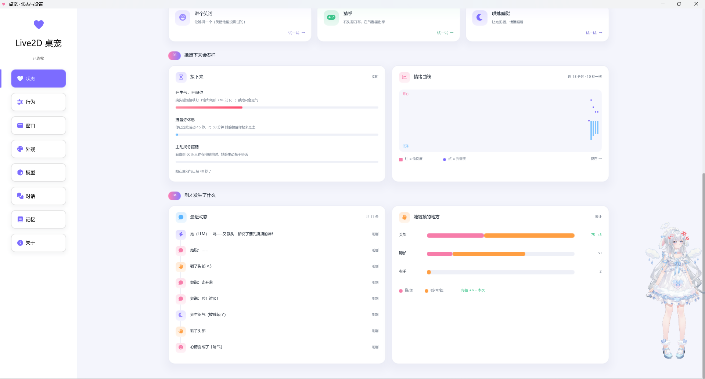
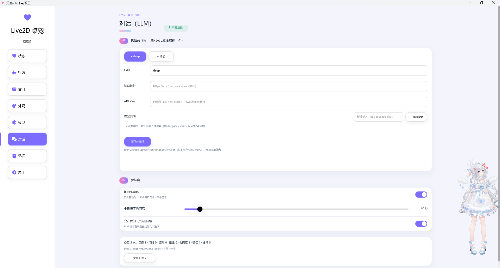

<div align="center">



# l2dpet

[简体中文](README.md) · [English](README.en.md) · [日本語](README.ja.md)

**🌸 Live2D × C++ × LLM — 让桌面多一个会回应你的伙伴。**

透明窗口 · 鼠标互动 · 对话与记忆 · Windows / Linux / macOS

[下载](https://github.com/jinsc123654/l2dpet/releases) · [源码构建](#build-from-source) · [反馈问题](https://github.com/jinsc123654/l2dpet/issues)


</div>

一只住在桌面上的 Live2D 角色。陪你工作、学习，也会在被触碰时回应、犯困时休息。
你可以使用本地互动和内置台词，也可以接入 LLM，让它与你聊天，留下记忆，拥有自己的性格。

## ✨ 功能

- **桌面陪伴**：透明置顶窗口、拖动、缩放与角色轮廓点击判定。
- **角色互动**：动作、表情、触摸反应、说话气泡与日夜行为。
- **对话与记忆**：可选 LLM 接入，支持跨会话记忆和每模型性格。
- **方便管理**：托盘菜单、设置面板、模型管理与多语言界面。
- **便携运行**：Windows 文件夹包与单文件便携包；Linux tar.gz、deb 和 AppImage 打包。

## 🖼️ 运行预览

### 桌面上的小伙伴

透明角色窗口与设置面板一起运行，休息时也会用气泡表达状态。



<details>
<summary>查看更多：状态与互动、情绪动态、LLM 设置</summary>

### 状态与互动

查看精力、亲密度与当前心情，也可以试试摸头、牵手、讲笑话和猜拳。



### 情绪与最近动态

情绪曲线、最近发生的互动和触摸统计，让角色的变化看得见。



### LLM 对话设置

在面板中配置服务提供方与模型，调整闲时互动的参与方式。



</details>

> 以上为 Windows 实际运行截图。截图中的角色为用户自备模型，仅展示运行效果，不包含在本仓库或安装包中；安装包的示例模型为 Hiyori。

## 📥 下载与使用

发布版本请查看 [GitHub Releases](https://github.com/jinsc123654/l2dpet/releases)。如果还没有适合的平台安装包，可以按下文从源码构建。

**Windows**：双击 `l2dpet-portable-x64.exe`；或解压文件夹包，双击 `l2dtest.exe`。设置面板随桌宠自动启动，便携包无需单独安装 VC++ 运行库。

**Linux**：tar.gz 解压后执行 `./install.sh`，再运行 `l2dpet`；AppImage 添加执行权限后运行。deb 使用系统的软件包管理器安装。

安装包包含官方示例模型 **Hiyori（桃瀬ひより）**。角色模型、动作与表情的可用范围取决于模型本身。

<a id="build-from-source"></a>

## 🛠️ 源码构建

### 📋 准备环境

```bash
git clone https://github.com/jinsc123654/l2dpet.git
cd l2dpet
```

本项目需要 **Cubism SDK for Native**，已验证的版本为 **5-r.5**。请从 [Live2D 官方下载页](https://www.live2d.com/en/sdk/download/native/) 获取并解压，使用 `CSM_SDK` 指向包含 `Core/`、`Framework/` 和 `Samples/` 的 SDK 根目录。

仓库包含 EUI-NEO 及其本地依赖、Cubism Core 的头文件和预编译库；完整 SDK 需要自行准备。Windows 首次构建会联网下载并静态编译 libcurl。

| 平台 | 构建环境 | 当前状态 |
| --- | --- | --- |
| Windows x64 | Visual Studio，安装“使用 C++ 的桌面开发”和 Windows SDK；CMake ≥ 3.14 | 已完成编译、打包及部分运行验证 |
| Linux | GCC/Clang、CMake、pkg-config、rsync，以及 OpenGL、X11、FreeType、Fontconfig、libcurl 开发包 | 已有构建、打包与运行验证 |
| macOS | Xcode Command Line Tools、CMake、pkg-config、libcurl、rsync | 提供构建支持，尚未完成实机验证 |

### 🪟 Windows

在仓库根目录打开 **cmd.exe**，运行：

```bat
set "CSM_SDK=C:\SDK\CubismSdkForNative-5-r.5"
scripts\windows_build.bat
```

脚本自动准备 SDK 构建树、编译主程序与面板，再生成：

```text
dist/
├── windows-x64/               # 文件夹便携包
│   ├── l2dtest.exe             # 桌宠
│   ├── l2dpet-ui.exe           # 设置面板
│   ├── assets/
│   └── models/
└── l2dpet-portable-x64.exe     # 单文件便携包
```

默认构建目录为 `%USERPROFILE%\l2d-build`，可用 `L2D_WORK` 修改。已有主程序和面板时，可用 `scripts\windows_build.bat --skip-build` 重新打包；生成单文件启动器仍需要 CMake 和 Visual Studio。

### 🐧 Linux

Debian/Ubuntu 的依赖安装示例：

```bash
sudo apt-get update
sudo apt-get install -y build-essential cmake pkg-config rsync unzip \
  libgl1-mesa-dev libx11-dev libxext-dev libxrender-dev libxft-dev \
  libxrandr-dev libxinerama-dev libxcursor-dev libxi-dev \
  libfreetype6-dev libfontconfig1-dev libcurl4-openssl-dev
```

准备 SDK 后构建并打包：

```bash
export CSM_SDK="$HOME/SDK/CubismSdkForNative-5-r.5"
bash scripts/linux_build.sh --no-deb
```

产物在 `dist/`。生成 deb 还需要 `dpkg-dev`；生成 AppImage 使用 `bash scripts/linux_build.sh --appimage`，首次需要下载打包工具。

只编译两个程序：

```bash
bash live2d/build-player.sh host
bash live2d/build-panel.sh
```

默认产物为 `~/l2d-build/build-host/l2dtest` 和 `~/l2d-build/build-panel/l2dpet-ui`。

### 🍎 macOS

准备好 SDK 与依赖后：

```bash
export CSM_SDK="$HOME/SDK/CubismSdkForNative-5-r.5"
export L2D_JOBS=4
bash live2d/build-player.sh host
bash live2d/build-panel.sh
```

macOS 尚未完成实机验证，欢迎反馈构建及运行问题。

## 🎭 更换模型

每个模型使用独立文件夹，保留 `.model3.json`、`.moc3`、纹理、动作与其他关联文件的相对路径。

| 平台 | 模型库目录 |
| --- | --- |
| Windows | `%USERPROFILE%\.local\share\l2dpet\models\` |
| Linux / macOS | `~/.local/share/l2dpet/models/` |

例如：`models/MyPet/MyPet.model3.json`。可以在设置面板中选择模型，也可以导入 ZIP 或目录。Windows 的 ZIP 导入使用系统自带的 `tar.exe`（Windows 10 1803 及以上）；首次导入会自动创建模型库目录。

请使用你拥有授权的模型，并遵守模型作者的使用与分发要求。

## 💬 配置 LLM

打开设置面板的“对话”页，填写服务地址、模型和 API Key。配置保存在 `~/.config/l2dpet/llm.json`；Windows 对应 `%USERPROFILE%\.config\l2dpet\llm.json`。

LLM 是可选功能。未配置时，本地互动和内置台词仍可使用。配置完成后，只有实际调用成功才显示“已连接”；调用失败时面板会提示原因。

“对话 → Token 节省”提供完整、均衡（默认）、节省、极省四档滑条。最近对话上下文分别使用 6、4、2、0 条消息；均衡和节省将小剧场平均间隔分别乘以 1.5 和 3，极省关闭自动小剧场，仍可主动互动。后三档对话回复上限分别为 1536、1024、768 Token；完整使用供应商默认上限。档位即时生效并保存，不删除已有记忆，也不限制性格、台词库与记忆整理的生成预算。

用量区显示最近一次与本次进程运行累计的对话及维护 Token（输入 → 输出），包括重试，重启清零；按供应商返回的用量统计，未返回时记为 0，不包含原生天气搜索。实际节省比例取决于模型和使用方式。若模型推理占用输出预算导致回复被截断，请降低节省档位。

开启天气功能并设置城市后，模型启动满 5 分钟会尝试天气关心，成功提交有台词的天气段后每小时一次；忙碌和睡眠时延后，不补播积压提醒。天气关心独立于普通小剧场开关，手动“聊聊天气”仍可立即触发。右键快捷菜单保留摸头、牵手、逗开心、捏脸、睡眠、笑话、猜拳与天气等互动，以及状态与设置、锁定大小和位置、鼠标穿透、隐藏到托盘和退出；模型、外观、动作和表情在设置中管理。

启用 LLM 后，对话及相关上下文会发送给你配置的服务提供方。请勿将 API Key 或个人配置提交到仓库。

题库使用稳定 ID 关联候选问题与回答；同一题只主动询问一次，没点选项也不会反复追问。均衡、节省和极省档只在当前题库全部问过后自动更新，不因剩余题目少或超过 24 小时提前更新；完整档保留不足 3 题或超过 24 小时更新的规则。问过和答过的记录会在题库更新、重启后保留，旧题库自动补齐 ID。台词显示前会拦截重复题和无法关联候选的自创选择题；“平时做什么 / 工作还是上学”等工作学习问法还会按同一意图去重。

## ❓ 常见问题

### 拉取源码就能直接构建吗？

需要先安装对应平台的编译工具，并准备官方 Cubism Native SDK。Windows 首次构建还需要联网下载 libcurl。

### 没有 API Key 能使用吗？

可以。LLM 为可选功能，基础桌宠互动不依赖在线服务。

### Windows 双击没有反应，如何查看日志？

查看 `%TEMP%\l2dpet.log`；单文件启动器的日志位于 `%TEMP%\l2dpet-portable.log`。反馈问题时请附上系统版本、构建方式和相关日志，隐藏其中的个人信息。

### Wayland 可以使用吗？

项目提供 GLFW 桌宠端口；透明、窗口定位、置顶和鼠标交互的表现取决于桌面合成器，建议在实际桌面环境中验证。

## 🧩 技术结构

`l2dtest` 负责 Live2D 角色、行为与内置 LLM agent；`l2dpet-ui` 负责托盘和设置面板。两者通过本机 `127.0.0.1:23333` 的 JSON Lines 接口通信。

```text
live2d/player/          桌宠与角色行为（C++17）
live2d/panel/           托盘与设置面板（EUI-NEO）
live2d/3rd/             第三方依赖
live2d/bundled-models/  随包示例模型
live2d/tools/           调试工具与便携启动器
scripts/               构建与打包脚本
```

## 📜 许可证

本项目自有代码采用 [MIT License](LICENSE)。第三方组件遵循各自许可证，相关许可与版权声明随源码保留。

**Live2D Cubism Core 是专有组件，不属于 MIT 授权范围。** 使用及分发时请遵守其随附许可与 Live2D 官方条款。

随包 Hiyori 示例模型版权归 Live2D Inc.，使用与分发受 Live2D Free Material License Agreement 约束；详见 [模型授权说明](live2d/bundled-models/README.md)。其他模型的授权由各自作者规定。

## 🙏 致谢

感谢 Live2D、EUI-NEO，以及 GLFW、FreeType、libcurl 等开源组件的作者与贡献者。

欢迎通过 [Issues](https://github.com/jinsc123654/l2dpet/issues) 反馈问题，或提交 Pull Request 一起完善这个桌面伙伴。

## 外部接入

设置 → 外部接入：Codex 工作消息陪伴、Hook 自动反馈、MCP 消息转发及可修改的默认本地端口 23333。接入需要 Python 3.9+，详见 [接入说明](EXTERNAL-INTEGRATION.md)。

本机控制连接需要先认证。面板和随包工具会自动读取当前用户、当前端口的私有控制 Token；未认证请求不会执行，Token 不会进入通知、备份或日志。旧版自写客户端需要按接入说明增加认证握手，并在桌宠重启后重新读取凭据。
